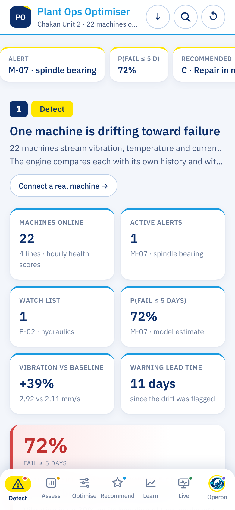
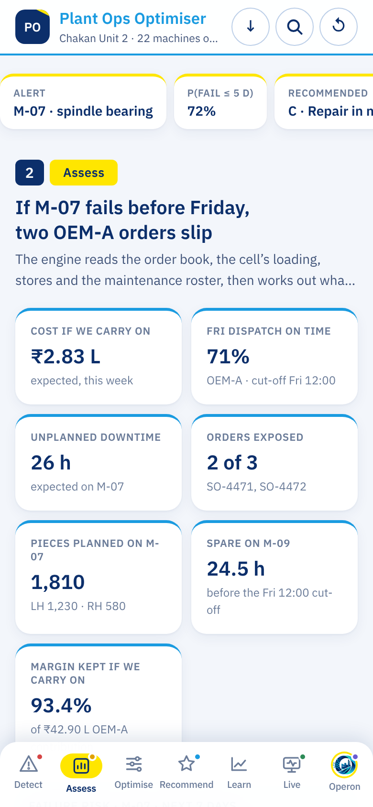
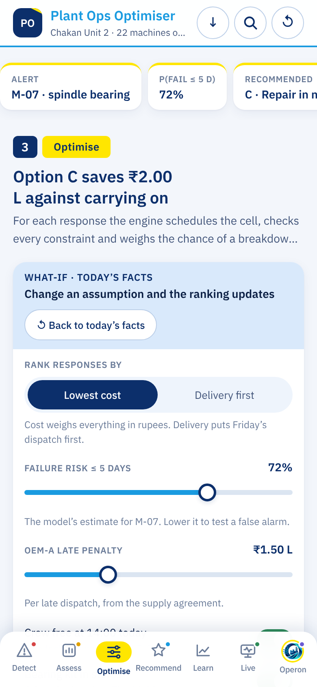
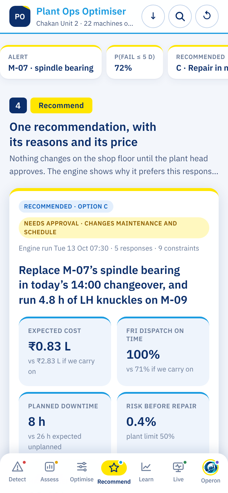
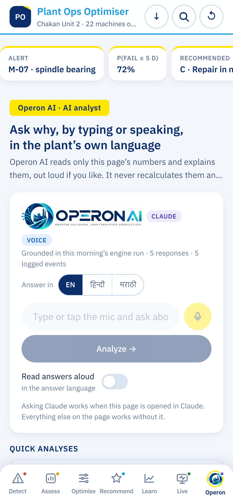
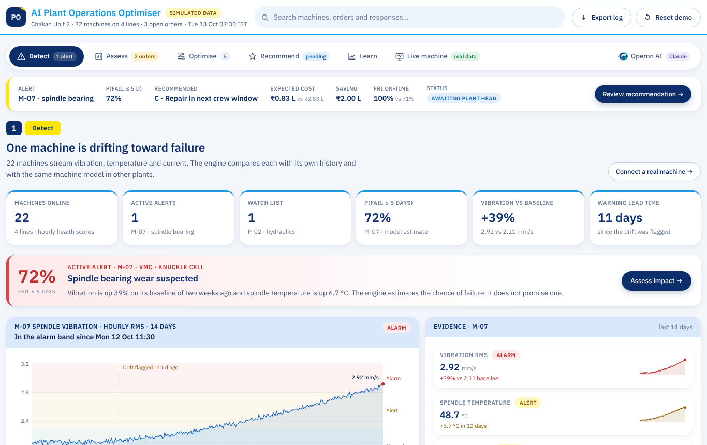
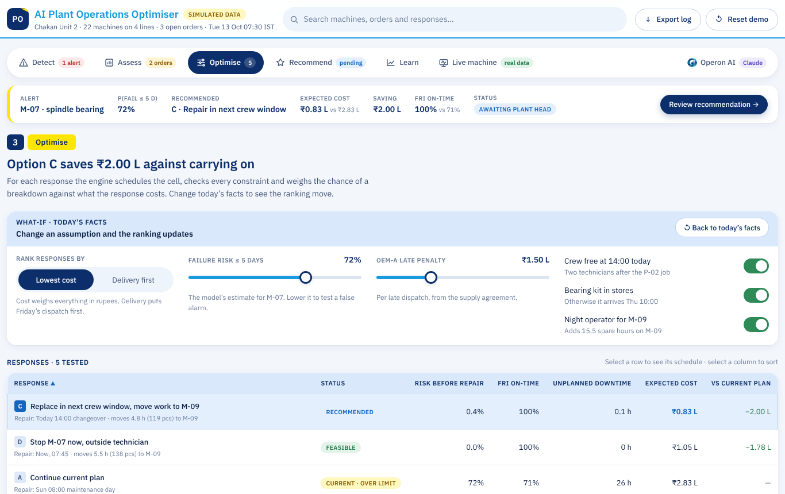

# Ai-shadowfox

A model that is helpful in reducing machine cost.

**AI Plant Operations Optimiser** spots machines drifting toward failure and recommends the cheapest response that keeps customer orders on time. It runs as a phone app in two ways: an Android APK, or a web app you add to your home screen.

## Screenshots

On a phone (and in the Android app):

| Detect | Assess | Optimise | Recommend | Operon AI |
| --- | --- | --- | --- | --- |
|  |  |  |  |  |

On a laptop or desktop the same page uses the full screen width:

| Detect | Optimise |
| --- | --- |
|  |  |

## Download

| What | Link |
| --- | --- |
| Android app (APK) | https://github.com/vcnexus6-creator/Ai-shadowfox/releases/download/apk-latest/plant-ops-optimiser.apk |
| App as one HTML file, for phones | https://github.com/vcnexus6-creator/Ai-shadowfox/releases/download/apk-latest/plant-ops-optimiser.html |
| Same page, for laptops and desktops | https://github.com/vcnexus6-creator/Ai-shadowfox/releases/download/apk-latest/plant-ops-website.html |

Both are rebuilt on every merge to `main`. While the repository is private, these links ask for a GitHub sign-in with access to the repo; once it is public, anyone with the link can download.

To build the HTML files yourself: `python3 tools/build_single_html.py` (writes `dist/plant-ops-optimiser.html` and `dist/plant-ops-website.html`).

## Install on a phone

### Android (APK)
1. Open the repo's **Actions** tab, then **Android APK**, then the latest green run.
2. Download **plant-ops-optimiser-apk** (a zip), unzip it on the phone and tap `plant-ops-optimiser.apk`.
3. Allow "install unknown apps" for your browser or file manager when Android asks.

After a merge to `main`, the APK is also published under **Releases → apk-latest**, so the phone can download it directly.

### Android or iPhone (web app)
1. One-time setup: in the repo, go to **Settings → Pages** and set **Source** to **GitHub Actions**.
2. After a merge to `main`, the **Web app** workflow publishes the app to GitHub Pages.
3. Open that link on the phone. On Android, tap **Install app**; on iPhone, tap **Share → Add to Home Screen**.

The web app works offline once it has been opened.

## Project layout

| Path | What it is |
| --- | --- |
| `app/www/index.html` | The app: Detect, Assess, Optimise, Recommend, Learn, Live machine and Operon AI; phone layout on narrow screens, full width on wide ones |
| `app/www/app-v2.html`, `app/www/engine.js` | An alternative native-style app design (Home, Impact, Options, Plan, Learn); kept but not used by the builds |
| `app/www/` (other) | Manifest, service worker, icons |
| `app/android/` | Capacitor Android project that wraps `app/www` |
| `app/assets/` | Source images for the Android icon and splash screen |
| `.github/workflows/` | Builds the APK and publishes the web app |

## Work on it locally

```bash
cd app
npm install
npm run serve            # preview at http://localhost:8080
npm run android:sync     # copy www/ into the Android project after editing
npm run android:open     # open in Android Studio to run on a phone or emulator
npm run android:icons    # regenerate icons/splash from app/assets/
```

## Notes

- All plant, machine, order and cost data is simulated.
- Operon AI's answers need the page to be opened inside Claude. In the APK or web app, Operon AI switches itself off and shows a note; everything else works.
